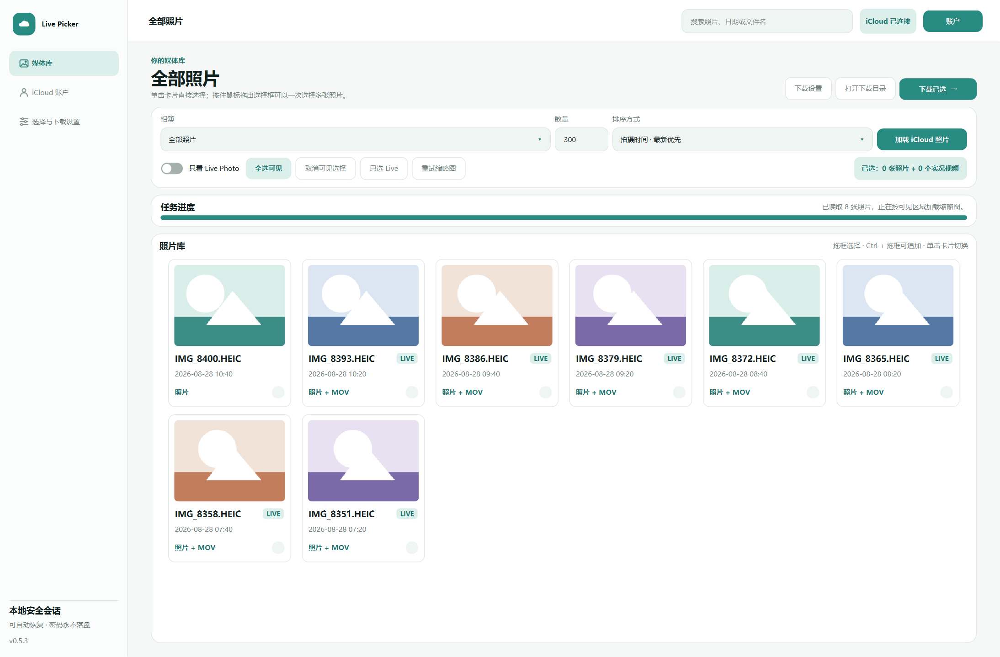
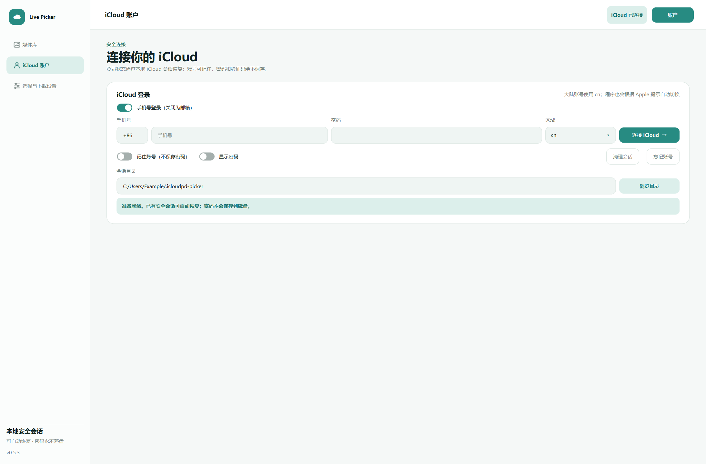

<div align="center">
  
  <h1>iCloud Live Photo Picker</h1>
  <p><strong>在 Windows 上浏览、框选并下载 iCloud 照片与完整 Live Photo。</strong></p>
  <p>先加载轻量缩略图，选中需要的内容后再下载原始照片和配套 MOV。</p>

  <p>
    
    
    
    
  </p>

  <p>
    <a href="#下载"><strong>下载</strong></a> ·
    <a href="#主要功能">主要功能</a> ·
    <a href="#界面预览">界面预览</a> ·
    <a href="#隐私与安全">隐私与安全</a> ·
    <a href="#从源码运行">从源码运行</a> ·
    <a href="CONTRIBUTING.md">参与贡献</a>
  </p>
</div>



> [!NOTE]
> 本项目处于 Beta 阶段，适合愿意自行保管账号会话并反馈问题的用户。本项目不是 Apple 或 icloudpd 官方软件。

## 下载

Windows 安装包、便携版和整理好的源码包统一放在 [百度网盘](https://pan.baidu.com/s/13qvegP94vbW2sPKHhcliOg?pwd=r8na)（提取码：`r8na`）。GitHub 仓库只发布源码、文档和版本标签，不托管 Windows 二进制安装包。

| 版本 | 文件 | 适合谁 |
| --- | --- | --- |
| **安装版（推荐）** | `iCloudLivePhotoPicker-v0.5.3-Setup.exe` | 希望拥有开始菜单、桌面快捷方式和正常卸载入口的用户 |
| 便携版 | `iCloudLivePhotoPicker-v0.5.3-windows-x64.zip` | 不想安装，或希望放在移动硬盘中使用的用户 |
| 源码 | GitHub 仓库，或网盘中的源码压缩包 | 开发、审计和自行构建 |

安装版与便携版均不要求另行安装 Python。便携版需要完整解压后运行其中的 `iCloudLivePhotoPicker.exe`，不能只复制单个 EXE。

> [!WARNING]
> 当前发布包尚未使用商业代码签名证书，Windows SmartScreen 可能显示“未知发布者”。请只使用上面的项目网盘链接下载，并核对 GitHub 版本说明中公布的 SHA-256。

## 主要功能

| 浏览与选择 | Live Photo | Windows 体验 |
| --- | --- | --- |
| 相簿、数量、筛选与多种排序 | 默认联动选择照片与配套 MOV | PyQt6 原生窗口、贴靠与最大化 |
| 虚拟化缩略图网格，适合大量照片 | 可切换为照片/MOV 独立选择 | 资源管理器式框选、`Ctrl` 追加选择 |
| 可调缩略图和预览清晰度 | 兼容部分 Windows 组件的 MOV 方向问题 | 边缘自动滚动、后台加载与下载进度 |

- 支持邮箱或手机号登录；手机号模式将区号与号码分开，新安装默认 `+86 / cn`。
- 点击文件名即可预览，支持上一张、下一张按钮及 `← / →` 快捷键。
- 下载原始照片、普通视频，以及 Live Photo 对应的照片 + MOV 资源。
- 仅保存账号标识、区域和本地会话；不把密码或双重认证验证码写入设置文件。

## 界面预览

<table>
  <tr>
    <td width="50%"></td>
    <td width="50%"></td>
  </tr>
  <tr>
    <td align="center">媒体库：筛选、排序、框选与下载</td>
    <td align="center">账号：邮箱/手机号登录与本地会话</td>
  </tr>
</table>

<table>
  <tr>
    <td></td>
    <td></td>
    <td></td>
  </tr>
</table>

## 快速开始

1. 安装应用，或完整解压便携版。
2. 使用 Apple 账号登录；中国大陆手机号账号通常使用 `+86` 与 `cn`。
3. 选择相簿、加载数量、排序方式和是否只看 Live Photo，然后加载媒体库。
4. 单击、`Ctrl` 单击或从空白处拖拽框选照片，再点击“下载所选”。
5. 下载完成后可直接打开保存目录。

默认下载目录是当前 Windows 用户的“图片”目录下的 `iCloudPicker`。可以在设置页更改；项目不会把开发者电脑上的路径作为默认值发布。

## Live Photo 与 MOV 方向

iCloud 返回的 Live Photo MOV 通常包含 QuickTime Display Matrix。部分 Windows 缩略图组件或播放器会忽略其中的镜像/旋转信息，导致照片方向正确而视频方向不同。

设置中的“Windows 兼容 MOV 方向”会把方向变换固化到视频像素，并保留音频、Live Photo 元数据轨、内容标识符和全局 QuickTime 元数据。该处理会对视频流进行一次高质量重编码；如需完全未经处理的文件，可关闭此选项。

## 隐私与安全

| 数据 | 保存位置与处理方式 |
| --- | --- |
| Apple 账号标识、区域、界面偏好 | `%APPDATA%\iCloudLivePhotoPicker\settings.json` |
| 密码、双重认证验证码 | 不写入本地设置文件 |
| iCloud 会话 | 由上游 `pyicloud_ipd` 默认保存在 `~/.icloudpd-picker` |
| 下载的照片与 MOV | 仅写入用户选择的本地目录，不由本项目自动上传 |

会话文件可以恢复登录，应按密码同等保护。提交 Issue 时，请勿上传 Apple 账号、手机号、验证码、cookie、会话文件、私人照片或完整敏感日志。安全问题请阅读 [SECURITY.md](SECURITY.md)。

Advanced Data Protection、FIDO 硬件安全密钥以及 Apple 登录接口变化仍受上游能力影响。

## 从源码运行

支持 Python 3.10–3.13。最简单的方式是双击 `run_windows.bat`；它会复用 `%LOCALAPPDATA%\iCloudLivePhotoPicker\venv-py版本号`，不会为每次版本更新重复创建环境。

手动开发安装：

```powershell
py -3.12 -m venv .venv
.\.venv\Scripts\python.exe -m pip install -e .
.\.venv\Scripts\python.exe -m icloud_live_picker
```

运行测试：

```powershell
$env:PYTHONPATH = "$PWD\src"
$env:QT_QPA_PLATFORM = "offscreen"
python -m unittest discover -s tests -v
```

## 构建 Windows 发布包

生成便携 EXE 和源码包：

```powershell
.\build_windows.bat
```

安装 Inno Setup 7 后生成完整安装包：

```powershell
.\build_installer.bat
```

产物位于 `dist/`：

```text
iCloudLivePhotoPicker-v0.5.3-Setup.exe
iCloudLivePhotoPicker-v0.5.3-windows-x64.zip
iCloudLivePhotoPicker-v0.5.3-source.zip
```

## 开源协作

- 遇到问题：使用 [Bug report](../../issues/new/choose)，附上最小复现步骤和 Windows 版本，但不要附带隐私数据。
- 提议功能：使用 [Feature request](../../issues/new/choose)，说明使用场景而不只是界面方案。
- 参与开发：阅读 [CONTRIBUTING.md](CONTRIBUTING.md)，提交前运行自动化测试。
- 查看变化：[CHANGELOG.md](CHANGELOG.md)。

第一次维护 GitHub 项目可参考仓库内的 [首次发布指南](docs/PUBLISHING.md)。GitHub 版本页只提供源码快照和版本说明，Windows 安装包与便携包由上面的百度网盘提供。

## 许可证与声明

本项目以 [GPL-3.0-or-later](LICENSE) 发布，以兼容社区版 PyQt6。第三方组件及 FFmpeg 二进制说明见 [THIRD_PARTY_NOTICES.md](THIRD_PARTY_NOTICES.md)。

Apple、iCloud、Live Photo 是其各自权利人的商标；项目名称仅用于说明兼容用途，不表示任何官方关联或认可。
